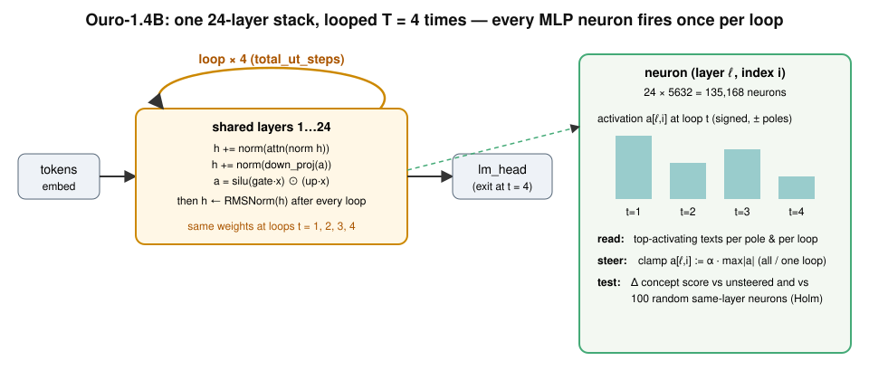
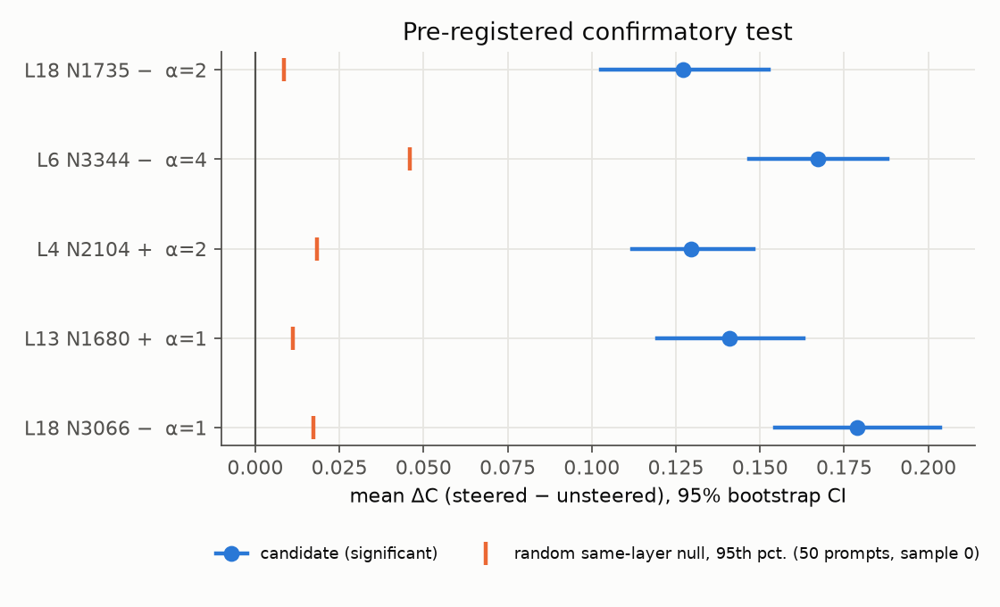
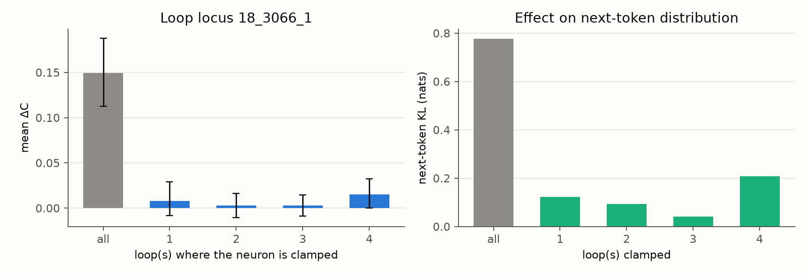
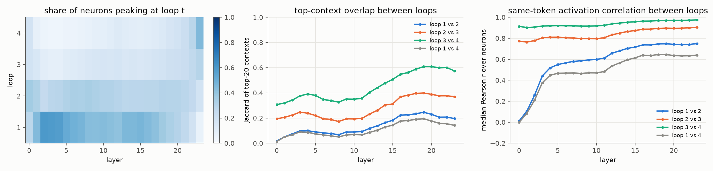
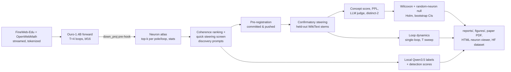
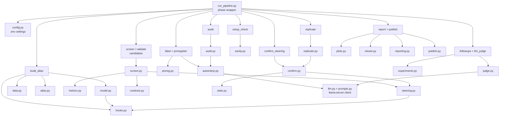

# Neurons of a Looped Language Model: neuron-level interpretability and causal steering of Ouro-1.4B

This repository studies **individual MLP neurons** of a **looped (recurrent-depth) transformer language model**, [ByteDance/Ouro-1.4B](https://huggingface.co/ByteDance/Ouro-1.4B) ([Zhu et al. 2025, arXiv 2510.25741](https://arxiv.org/abs/2510.25741)). The method follows Goodfire's neuron-reading approach in ["Neural Networks Are Already Clean"](https://already-clean.goodfire.com/) (Cammarata, Goodfire, Oct 2026): read raw neurons and their positive/negative poles directly from max-activating text, label them, then **steer and ablate** them against **random neurons from the same layer**.

Ouro runs the same 24 layers **four times** (`total_ut_steps = 4`), so every neuron fires **once per loop**. That gives each neuron a 4-step activation trajectory per token, which a standard transformer does not have. The pipeline asks three questions:
1. What do looped neurons encode?
2. Does a neuron do the same job at every loop?
3. Can one neuron, when clamped, change the model's behavior with **statistical significance** against pre-registered controls?

<p align="center"></p>

## Highlights

**Main result (pre-registered, positive).** All **5 of 5** pre-registered neurons steer Ouro-1.4B's text toward their concept with statistical significance. For each neuron:
- clamping that single neuron at all 4 loops raises the concept score of 48-token continuations on 100 held-out prompts (mean ΔC 0.13–0.18, d_z 0.99–1.61);
- Holm-adjusted Wilcoxon p ≤ 1.1e-15;
- it beats 99–100 of 100 random neurons from the same layer clamped the same way (Holm-adjusted permutation p = 0.0495, the smallest attainable value; 7–12 SD above the null mean);
- it passes the fluency guards (perplexity ratio 1.58–1.83, distinct-2 ≥ 0.80).

The five neurons and their concepts:
- L18 N3066−: phonetics and letters
- L13 N1680+: non-duality
- L4 N2104+: pedagogy
- L6 N3344−: forum "accepted answer"
- L18 N1735−: electron orbitals

Example (confirm prompt 2, sample 0):
- unsteered: "In the Philippines, Nepartak produced strong winds, heavy *rainfall, and flooding. In the Philippines, a total of 27 people died…*"
- with L18 N3066 clamped: "…heavy *rains, and severe flooding. The sounds of the letters /p/ and /t/ are softened. In the International Phonetic Alphabet (IPA)…*"

| Question | Test | Result |
|---|---|---|
| H1: does ≥1 neuron steer behavior significantly? | pre-registered: Wilcoxon vs unsteered **and** permutation vs 100 random same-layer neurons, Holm, fluency and degeneracy guards | **supported: 5/5 neurons** ([report](reports/03_confirmatory_test.md)) |
| Specificity | steer neuron i, score concept j | each neuron moves its own concept most, 1.4–3.8× the largest other concept ([report](reports/04_followups.md)) |
| Dose-response | α = 0.5…16 × max activation | monotone then **saturating**, as the sandwich RMSNorm predicts; opposite-sign clamps do nothing |
| H2: does a later loop matter more? | clamp at a single loop | **mostly no.** For the 5 confirmed neurons, single-loop clamps give ΔC ≤ 0.043, against 0.13–0.17 for all-loop; effects are super-additive across loops (self-repair). Exception: the exploratory if-statement neuron L19 N3901, where the last loop alone gives 56% |
| LLM judge (secondary) | blind AxBench-style 0–2 ratings by local Qwen3.5-9B, 50 prompts | concept 0 → 0.06–0.36 (all 5 Holm p ≤ 0.042); fluency 1.50 → 0.90–1.17 |
| Robustness (post hoc) | 3 new seed sets; teacher-forced concept-token probability | stable (ΔC 0.11–0.18 in every seed set, p ≤ 2.9e-8); clamping raises concept-vocabulary probability 1.6–2.6× (p ≈ 2e-18) ([report](reports/07_plan_completion.md)) |
| Self-repair (post hoc) | residual displacement kept at the output after a single-loop clamp | loops 1–3 keep 33–78%; loop 4 keeps 67–126% |
| H3: more test-time loops? | clamp at all loops for T = 1…8 | effect already present at T = 1, roughly flat in T; next-token KL grows with T |
| Necessity | zero-ablation vs 100 random ablations | 4 of 6 neurons needed for their own contexts (unadjusted p = 0.0099; exploratory); 2 neurons steer but are not necessary |
| Loop structure (descriptive) | where each neuron peaks; top-context overlap across loops | 41% of neurons peak at loop 1 vs 13% at loop 4; top-20 contexts at loop 1 vs loop 4 overlap only 1–19% (Jaccard) |
| Cross-loop function (descriptive) | same-token activation correlation, loop 1 vs 4 | median r = 0.54; adjacent loops converge (0.65 → 0.84 → 0.94); layer 0 ≈ 0 ([report](reports/05_loop_audit.md)) |
| H4: are looped neurons "loop-polysemantic"? | same-loop vs cross-loop detection of local-LLM explanations | **not supported** (0.60 vs 0.59, p = 0.20); the explainer is weak (0.60 vs 0.50 chance) |
| Replication on Ouro-1.4B-Thinking | same neuron indices, fresh seeds | **5/5 replicate** (ΔC 0.16–0.18, Holm p ≤ 2.1e-16, each beats 20/20 random neurons); weights nearly unchanged by SFT (cos ≥ 0.993) ([report](reports/06_replication.md)) |

<p align="center">


</p>
<p align="center">


</p>

**Artifacts:**
- Paper: [paper/paper.pdf](paper/paper.pdf).
- Reports: [summary](reports/summary.md), [pre-registration](reports/preregistration.md), and per-experiment reports in [reports/](reports/).
- Neuron viewer: [docs/viewer/](docs/viewer/index.html). Open it locally to see each neuron's top contexts at every loop.
- Hugging Face dataset with the full atlas and all results: [BurnyCoder/ouro-1.4b-neuron-atlas](https://huggingface.co/datasets/BurnyCoder/ouro-1.4b-neuron-atlas), in the collection [Looped-LM neurons](https://huggingface.co/collections/BurnyCoder/looped-lm-neurons-6add603667c872dddf85b800).

**Negative and cautionary findings:**
- **Degeneration.** Perplexity alone fails as a fluency guard. The if-statement neuron and a Fibonacci neuron reach the highest concept scores by degenerating into "ififif…" and "Fib Fib Fib…", which have *low* perplexity. A distinct-2 guard was added before the confirmatory run.
- **Not every neuron steers.** The five neurons were selected for steerability (existence claims), so they do not show that a typical neuron steers.

## Methodology (summary)

Full details are in [docs/methodology.md](docs/methodology.md). The pre-registration is in [reports/preregistration.md](reports/preregistration.md) and is committed before the confirmatory run.

**Model.** Ouro-1.4B ([model card](https://huggingface.co/ByteDance/Ouro-1.4B), revision `574fa66`):
- 24 decoder layers, d = 2048, 16-head MHA, vocab 49,152, about 1.4B parameters.
- Trained on 7.7T tokens.
- The whole stack is applied `total_ut_steps = 4` times with shared weights.
- **Sandwich RMSNorm** wraps both attention and MLP, and RMSNorm is applied after every loop.
- An early-exit gate exists. We always read the last loop (`exit_at_step = T-1`) so the computation stays fixed.
- Replication model: [Ouro-1.4B-Thinking](https://huggingface.co/ByteDance/Ouro-1.4B-Thinking), same architecture.

**Neuron.** The unit is element *i* of the SwiGLU activation that enters `down_proj` in layer ℓ:

```text
a[ℓ, i, t] = silu(gate_proj · x)_i · (up_proj · x)_i          (x = RMSNorm of the residual stream at loop t)
```

- There are 24 × 5632 = 135,168 neurons.
- Activations are **signed**, so each neuron has a positive pole and a negative pole, following Goodfire.
- A forward pre-hook on `down_proj` reads or edits `a`. A per-layer call counter gives the loop index *t*.

**Data.**
- The **neuron atlas** streams [FineWeb-Edu](https://huggingface.co/datasets/HuggingFaceFW/fineweb-edu) (90%) and [OpenWebMath](https://huggingface.co/datasets/open-web-math/open-web-math) (10%). It uses about 8M tokens in 256-token chunks, without caching the corpus to disk.
- **Steering prompts** are 12-token stems from the [WikiText-103](https://huggingface.co/datasets/Salesforce/wikitext) *test* split. This corpus is disjoint from the atlas text, and using it reduces the chance of memorized continuations.
- Prompts are split once, with a fixed seed, into a **discovery** set (used for selection) and a **confirmatory** set (used only for the pre-registered test).

**Pipeline.**
1. **Atlas.** For every neuron and pole, collect:
   - the top-40 contexts over all positions and loops;
   - the top-20 contexts at each loop;
   - the loop where the activation peaks;
   - per-loop mean, mean |a|, SD, positive fraction and threshold-exceedance counts (on every 8th batch), plus dead-neuron flags.
   Top-k is computed by streaming `torch.topk` merges on the GPU, following the max-activating-examples practice of [Bills et al. 2023](https://openaipublic.blob.core.windows.net/neuron-explainer/paper/index.html).
2. **Candidate screen** (discovery data only).
   - Rank neurons by *semantic coherence* of their top contexts: mean pairwise cosine of [bge-small-en-v1.5](https://huggingface.co/BAAI/bge-small-en-v1.5) embeddings.
   - Drop pure token or position detectors ([Voita et al. 2023](https://arxiv.org/abs/2309.04827)).
   - Quick-steer the 200 most coherent units at α ∈ {1, 2, 4} on 25 discovery prompts.
   - Validate the top 10 on 100 other discovery prompts.
   - Keep the K = 5 units with the largest validation d_z among those that pass the fluency (perplexity) and degeneracy (distinct-2) guards.
3. **Labeling.** A local **Qwen3.5** model served by [llama.cpp](https://github.com/ggml-org/llama.cpp) writes explanations from top examples. It uses the Delphi explainer format and **detection scoring** from [Paulo et al. 2024](https://arxiv.org/abs/2410.13928) ([code](https://github.com/EleutherAI/delphi)), with a shuffled-label chance control. Every prompt and output is logged in full.
4. **Steering.** Clamp `a[ℓ,i,t] := α · max|a|` on the neuron's pole, at all positions and all (or one) loops.
   - Sample k = 3 continuations of 48 tokens per prompt.
   - Steered and unsteered runs use **the same sampling seeds** (paired design).
5. **Primary metric.** The *concept score* is the cosine between the continuation's embedding and the neuron's **contrastive concept direction**: normalize(mean embedding of the neuron's top contexts − mean embedding of random contexts). It involves no LLM, which avoids label circularity.
   - Secondary metrics: an AxBench-style blind LLM judge ([Wu et al. 2025](https://arxiv.org/abs/2501.17148)), perplexity under the unsteered model, distinct-2 repetition rate, and a second embedder.
6. **Statistics.**
   - A one-sided Wilcoxon signed-rank test vs unsteered.
   - An empirical permutation p-value vs **R = 100 random alive neurons from the same layer** steered at the same relative α.
   - Holm correction across candidates.
   - d_z and rank-biserial effect sizes with bootstrap 95% CIs.
   - Power analysis via `statsmodels`.
   - A pre-registered decision rule that includes a fluency guard (median perplexity ratio ≤ 2) and a degeneracy guard (median steered distinct-2 ≥ 0.6).
7. **Loop dynamics.**
   - Steer at a single loop t ∈ {1..4} to test the "late-loop matters most / early injections get repaired" observation reported for Ouro-1.4B-Thinking ([nesiacel, LessWrong 2026](https://www.lesswrong.com/posts/rzcJMpnehFBD686gj/a-recurrent-llm-is-quite-easy-to-interpret-but-complex-to)).
   - Sweep the test-time loop count T = 1…8.
   - Test the saturation predicted by the sandwich norm: clamping one neuron to a huge value makes the layer's MLP write tend to `g ⊙ w_i / rms(w_i)`, which is bounded.
8. **Interpretability audit.**
   - Sample 150 neurons (50 per layer tercile).
   - Write explanations at loop 1 and at loop 4.
   - Score each explanation on held-out contexts from the same loop and from the other loop (loop-polysemanticity), with a shuffled-explanation control.
   - Also compute every neuron's same-token activation correlation between loops on held-out text.
9. **Replication.** Map neurons by weight similarity and re-test the significant neuron(s) on Ouro-1.4B-Thinking.

## What happens when you run it (data flow)



Each phase writes a timestamped log, `logs/<YYYYmmdd-HHMMSS>_<phase>.log`, and prints to the terminal. LLM prompts and outputs are logged in full, never truncated. Results go to `results/<model>/` as JSON, JSONL, NPZ, and the `atlas.pt` torch file.

## Code architecture



## Features
- Loads Ouro deterministically: pinned revision, fixed exit step, no stochastic early exit.
- Records and steers neurons per loop, for both poles, through a single hook object. The hook object is verified by unit tests against a manual SwiGLU recomputation.
- Builds a streaming GPU top-k neuron atlas (positive and negative poles, per loop) with dead-neuron and loop-of-max statistics.
- Runs a local, free LLM labeler and judge (Qwen3.5 GGUF via llama.cpp). Outputs are parsed from the published formats (Delphi `[EXPLANATION]:` and `[0,1,...]` lists, AxBench `Rating: [[n]]`), and everything is logged in full.
- Runs a pre-registered confirmatory steering test with paired seeds, random same-layer neuron nulls, Holm correction, bootstrap CIs, and a power analysis.
- Analyzes loop dynamics: single-loop steering, test-time loop sweeps, and saturation predictions.
- Generates a static HTML "microscope" page per neuron, with token heatmaps per loop.
- Produces reports, figures, and a paper PDF, all generated from result files.

## Technologies
- [PyTorch](https://pytorch.org/) 2.14 (CUDA 13.0 wheels, which support Blackwell sm_120)
- [transformers](https://github.com/huggingface/transformers) 4.57.6; the pinned Ouro revision includes the KV-cache fix for transformers>=4.56 and fails on 4.54.1
- [datasets](https://github.com/huggingface/datasets) (streaming)
- [sentence-transformers](https://www.sbert.net/) with bge-small-en-v1.5 and all-MiniLM-L6-v2
- [SciPy](https://scipy.org/) and [statsmodels](https://www.statsmodels.org/)
- [llama.cpp](https://github.com/ggml-org/llama.cpp) `llama-server` running a [Qwen3.5](https://huggingface.co/Qwen/Qwen3.5-9B) GGUF, called through the [openai](https://github.com/openai/openai-python) client
- [Typst](https://typst.app/) for the paper
- [uv](https://docs.astral.sh/uv/) for the environment

## Installation

Requirements:
- Windows or Linux.
- An NVIDIA GPU with at least 8 GB of VRAM. Development used an RTX 5070 Laptop GPU with 8 GB.
- About 19 GB of free disk:
  - venv ≈ 5.5 GB
  - two Ouro checkpoints ≈ 5.7 GB
  - Qwen3.5-9B Q4_K_M GGUF ≈ 6 GB
  - llama.cpp ≈ 0.6 GB

```bash
git clone https://github.com/BurnyCoder/looped-transformers-llms-neuron-mechanistic-interpretability
```

```bash
cd looped-transformers-llms-neuron-mechanistic-interpretability
```

```bash
uv sync
```

```bash
cp .env.example .env
```

The local labeler/judge is needed only for the labeling, LLM-judge, and audit phases. Steering statistics use the LLM-free concept score. Setup:
1. Download the llama.cpp CUDA build (release b11854) into `tools/llama.cpp/`.
2. Download `Qwen3.5-9B-Q4_K_M.gguf` into `cache/gguf/`.

Exact commands are in [docs/setup.md](docs/setup.md). The pipeline starts and stops `llama-server` itself, on port 8093, after unloading Ouro from the GPU.

## Usage

The model, revision, token budgets, seeds and LLM settings live in `.env` (template: `.env.example`).

Run every phase in order:

```bash
uv run python run_pipeline.py
```

The phase order is:
1. setup_check
2. build_atlas
3. screen_candidates
4. validate_candidates
5. label_candidates
6. preregister
7. confirm_steering
8. followups
9. llm_judge
10. audit
11. replicate
12. report
13. publish

Notes on running it:
- `build_atlas` skips work if a finished `atlas.pt` exists. Other phases recompute.
- `confirm_steering` refuses to run until `reports/preregistration.md` is committed to git and unchanged. Commit and push it after `preregister`, then continue with `--phase confirm_steering` and the later phases.
- `publish` uploads to the Hugging Face dataset named in `run_pipeline.py`. Change `HF_DATASET` to your own repo before using it.

Smoke-test every phase on a tiny budget:

```bash
uv run python run_pipeline.py --dry-run
```

Run a single phase:

```bash
uv run python run_pipeline.py --phase build_atlas
```

Run the unit tests. GPU tests are marked `gpu`:

```bash
uv run pytest -q
```

## Repository layout
```
run_pipeline.py        # one wrapper calling the named phases
src/loopneuron/        # config, logging_utils, model, hooks, data, atlas, contexts, metrics, steering, screen, prereg,
                       # confirm, experiments, judge, audit, replicate, llm, prompts, autointerp, stats, sanity,
                       # plots, viewer, reporting, publish
tests/                 # pytest unit tests (hooks vs manual SwiGLU, KV cache, top-k vs brute force, stats, steering logic)
data/prompts/          # discovery / confirm / reserve prompt splits (WikiText-103 test stems)
results/Ouro-1.4B/     # all result JSONs (atlas.pt and token caches are gitignored; published on Hugging Face)
figures/               # all figures (generated by the report phase)
reports/               # summary, pre-registration, per-experiment reports, generated tables
docs/                  # methodology, setup, neuron viewer (docs/viewer/)
paper/                 # Typst source + PDF (build: uv run python paper/build.py)
logs/                  # timestamped phase logs incl. every LLM prompt/output
```

## Related work
- **Goodfire, *Neural Networks Are Already Clean*** (2026): raw-neuron reading, poles, steering, random same-layer controls. https://already-clean.goodfire.com/
- **Zhu et al., *Scaling Latent Reasoning via Looped Language Models*** (Ouro, 2025). https://arxiv.org/abs/2510.25741
- **Arroyo et al., *A Mechanistic Analysis of Looped Reasoning Language Models*** (2026): cyclic fixed points and stages of inference in looped LMs. https://arxiv.org/abs/2604.11791
- **Residual-direction steering of Ouro across loops**, done with directions rather than single neurons:
  - nesiacel (LessWrong, 2026). https://www.lesswrong.com/posts/rzcJMpnehFBD686gj/a-recurrent-llm-is-quite-easy-to-interpret-but-complex-to
  - Suiche (2026). https://msuiche.com/posts/abliterating-a-loop-control-vectors-meet-the-looped-transformer/
- **Neuron studies:**
  - Gurnee et al. 2024, universal neurons: https://arxiv.org/abs/2401.12181
  - Stolfo et al. 2024, confidence-regulation neurons: https://arxiv.org/abs/2406.16254
  - Geva et al. 2022, FFN value vectors: https://arxiv.org/abs/2203.14680
- **Steering evaluation:**
  - AxBench: https://arxiv.org/abs/2501.17148
  - ActAdd: https://arxiv.org/abs/2308.10248
- **Methodology:** Lones, *How to avoid machine learning pitfalls*: https://arxiv.org/abs/2108.02497

## License
The code is MIT. Ouro weights are Apache-2.0 (ByteDance). Qwen3.5 weights are Apache-2.0.
