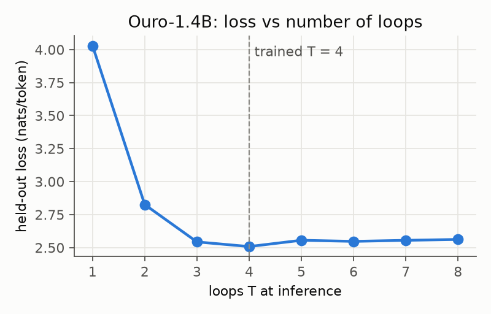

# Experiment 1: Model sanity check and neuron atlas

**Status:** done. **Data:** `results/Ouro-1.4B/setup_check.json`, `results/Ouro-1.4B/atlas.pt` (published on Hugging Face, see README), `results/Ouro-1.4B/loop_structure.json`. **Logs:** `logs/20261025-044044_setup_check.log` (the run that wrote the current `setup_check.json`; the first run, `logs/20261024-165146_setup_check.log`, gave the same losses), `logs/20261024-165339_build_atlas.log`.

## Setup check (phase 0)
Before any analysis we checked three things:
- the model behaves like the published Ouro-1.4B;
- the loop count T can be changed at inference time;
- the default early-exit path does not change which loop is read out.

Held-out data: 64 FineWeb-Edu chunks of 256 tokens, taken from a parquet shard (`sample/10BT/013_00000`) that the atlas never reads.

| loops T | 1 | 2 | 3 | **4 (trained)** | 5 | 6 | 7 | 8 |
|---|---|---|---|---|---|---|---|---|
| loss (nats/token) | 4.030 | 2.826 | 2.543 | **2.508** | 2.556 | 2.547 | 2.555 | 2.562 |
| perplexity | 56.2 | 16.9 | 12.7 | **12.3** | 12.9 | 12.8 | 12.9 | 13.0 |

- Loss falls steeply up to the trained depth T = 4 and gets slightly worse when extrapolating to T = 5–8. This is in line with the Ouro paper, where recurrent steps help up to the trained depth and benchmark performance shows "a moderate degradation" when extrapolating beyond it (§5.3 of [Zhu et al. 2025](https://arxiv.org/abs/2510.25741)). 
- The default early-exit path (threshold 1.0 on a bf16 cumulative exit distribution) and the fixed last-loop exit we use disagreed on **0 of 2,048** positions. We still set `model.early_exit_step = T-1` (`loopneuron.model.load_model`), so the logits always come from the last loop by construction. Ouro always executes all T loops; the exit setting only chooses which loop's hidden state feeds `lm_head` ([modeling_ouro.py](https://huggingface.co/ByteDance/Ouro-1.4B/blob/574fa66cb8bf5abdc979642d01cf2b79b16bfab1/modeling_ouro.py)).
- Sampled continuations are fluent; they are in the log.

## Atlas (phase 1)
- **Neuron definition:** a = silu(gate·x) ⊙ (up·x), read at the input of `down_proj` in all 24 layers × 5,632 neurons = **135,168 neurons**, at each of the 4 loops.
- **Text:** 8,000,000 tokens (31,250 chunks of 256 tokens), packed with EOS separators. Documents are drawn from FineWeb-Edu with probability 0.9 and from OpenWebMath with probability 0.1 (`datasets.interleave_datasets`); the resulting token share was not measured.
- **What is stored:** top-40 contexts per neuron and pole (maximum over positions 4–255 × loops; the first 4 positions of every chunk are skipped) and top-20 contexts per loop. Moments are computed on every 8th batch (987,840 tokens per layer and loop).
- **Runtime:** 72.5 min, ≈ 1,840 tokens/s on average on an RTX 5070 Laptop GPU (the log's last progress line reads 1,839 tok/s; 8,000,000 tokens / 72.5 min = 1,839 tok/s).
- **Dead neurons:** none (max |a| ≥ 10⁻³ for all 135,168). Median max |a| is 0.64 (1st percentile 0.025, 99th 6.94). Source: `atlas.pt` keys `dead` and `top_v`.

### Loop structure (descriptive, all neurons)
| statistic | loop 1 | loop 2 | loop 3 | loop 4 |
|---|---|---|---|---|
| share of neuron poles whose strongest context is at this loop (both poles pooled) | 0.410 | 0.297 | 0.167 | 0.127 |

| top-20 context overlap (Jaccard of chunk ids, positive pole, 500 random alive neurons per layer), mean over layers | loop 1 vs 2 | loop 2 vs 3 | loop 3 vs 4 | loop 1 vs 4 |
|---|---|---|---|---|
| | 0.137 | 0.276 | 0.446 | 0.01–0.19 by layer (0.01 at layer 0, highest at layer 19, 0.14 at layer 23) |

Interpretation: hedged and descriptive. The contexts that drive a neuron hardest change a lot from loop 1 to loop 4, and loops become more similar as computation proceeds. This fits convergence toward a fixed point ([Blayney et al. 2026](https://arxiv.org/abs/2604.11791)). Top-k overlap is sensitive to near-ties, so the audit phase adds the per-neuron Pearson correlation of activations between loops on the same held-out tokens ([Experiment 5](05_loop_audit.md)).

## Learnings
- **transformers version.** The [model card](https://huggingface.co/ByteDance/Ouro-1.4B) recommends `transformers<4.56`, but the pinned Ouro revision already contains the KV-cache fix for ≥ 4.56 ([commit 7ea635b](https://huggingface.co/ByteDance/Ouro-1.4B/commit/7ea635ba1575ae9ab4ae1d83d83e16a6e47fe696), "Update Ouro Cache"). It fails on 4.54.1 with "`key_cache` has no setter" (`Cache.key_cache` is a read-only property in transformers 4.54), so we use 4.57.6.
- **Statistics overhead.** Computing the full statistics on every batch made the atlas much slower in development runs (the exact slowdown was not logged). Top-k needs every batch; moments do not, so they are subsampled with whole batches, which keeps them unbiased.
- **Download size.** WikiText's default `load_dataset` call downloads the 300 MB train split. We load the 0.7 MB test parquet directly.
- **Prompt/atlas overlap.** None of the 750 WikiText prompt stems occurs verbatim in the 8M atlas tokens (a hash lookup has no false negatives, so 0 hits is exact). Check: hash every 12-token window of `cache/tokens_atlas.npy` (`numpy.lib.stride_tricks.sliding_window_view`) and look up each stem's `ids` from `data/prompts/*.jsonl`.
