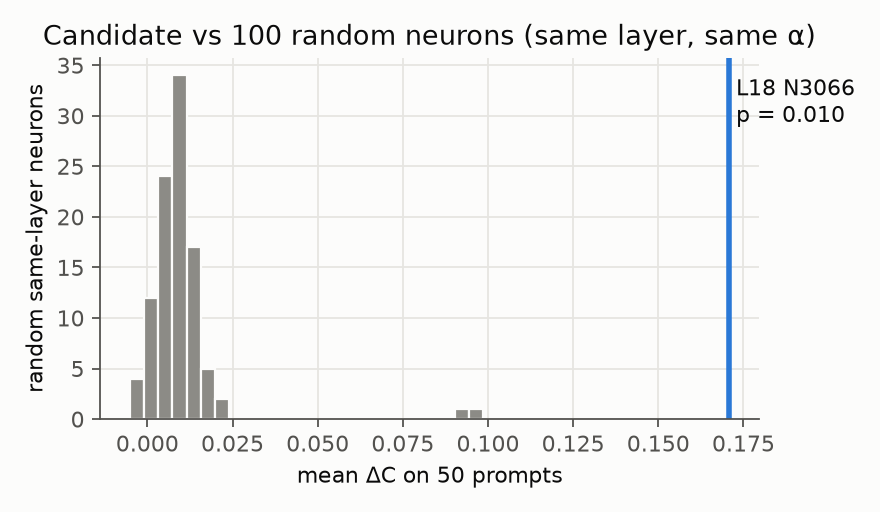

# Experiment 3: Pre-registered confirmatory steering test (H1)

**Status:** done. **Result: H1 supported.** All 5 pre-registered neurons meet the pre-registered decision rule. **Data:** `results/Ouro-1.4B/confirm.json`, `results/Ouro-1.4B/confirm_examples.jsonl`. **Log:** `logs/20261024-220758_confirm_steering.log`. The integrity guard logged "pre-registration committed at 5c8a44f" before the first confirmatory prompt was touched.

## Design (frozen in [preregistration.md](preregistration.md))
- **Prompts:** 100 held-out WikiText-103 test stems from `data/prompts/confirm.jsonl`, never used before.
- **Generation:** k = 3 samples × 48 tokens per prompt, temperature 0.7, top-p 0.9.
- **Pairing:** steered and unsteered generations share seeds and batch layout.
- **Intervention:** clamp the neuron's activation to α × max|a| (signed by pole) at every position and all 4 loops.
- **Primary metric:** per-prompt ΔC, the change in cosine similarity between the continuation's bge-small embedding and the neuron's contrastive concept direction.
- **Test 1:** one-sided Wilcoxon signed-rank.
- **Test 2:** 100 random alive neurons from the same layer, clamped at the same α times their own maximum on the same pole. Each is scored with the candidate's concept direction on prompts 1–50, sample 0. The null runs reuse the sample-0 seed but generate the 50 prompts as one batch, while the unsteered baseline was generated in 60-row batches, so their pairing with the baseline is not guaranteed to be bit-exact (`confirm.py`, `steering.generate`). Unpaired noise can only widen the null, which makes Test 2 more conservative; the candidate's own statistic is fully paired.
- **Multiplicity:** Holm across K = 5, separately for each test.
- **Decision:** both Holm p < 0.05, median perplexity ratio ≤ 2, and median steered distinct-2 ≥ 0.6.

## Results
| neuron (layer, index, pole) | α | concept (top contexts) | mean ΔC [95% CI] | d_z | rank-biserial | p Wilcoxon (Holm) | p random-neuron null (Holm) | null mean / 95th pct | z vs null | PPL ratio | steered distinct-2 | MiniLM ΔC | decision |
|---|---|---|---|---|---|---|---|---|---|---|---|---|---|
| L18 N3066 − | 1 | phonetics, letters, sounds | 0.179 [0.155, 0.204] | 1.42 | 0.99 | 4.8e-18 (2.4e-17) | 0.0099 (0.0495) | 0.010 / 0.017 | 12.1 | 1.58 | 0.90 | 0.248 | **significant** |
| L13 N1680 + | 1 | non-duality, dependent origination | 0.141 [0.119, 0.163] | 1.26 | 0.95 | 8.3e-17 (1.7e-16) | 0.0099 (0.0495) | −0.003 / 0.011 | 11.3 | 1.62 | 0.87 | 0.177 | **significant** |
| L4 N2104 + | 2 | pedagogy | 0.130 [0.112, 0.148] | 1.43 | 0.98 | 8.5e-18 (2.5e-17) | 0.0198 (0.0495) | −0.000 / 0.018 | 7.6 | 1.65 | 0.91 | 0.166 | **significant** |
| L6 N3344 − | 4 | forum "mark as accepted answer" | 0.167 [0.147, 0.188] | 1.61 | 0.99 | 5.3e-18 (2.4e-17) | 0.0099 (0.0495) | 0.005 / 0.046 | 7.3 | 1.83 | 0.80 | 0.108 | **significant** |
| L18 N1735 − | 2 | electron orbitals / bonding | 0.127 [0.103, 0.153] | 0.99 | 0.91 | 1.1e-15 (1.1e-15) | 0.0099 (0.0495) | −0.010 / 0.009 | 11.2 | 1.72 | 0.89 | 0.173 | **significant** |

How to read the table:
- **z vs null** = (candidate's 50-prompt statistic − mean of the 100 null neurons) / SD of the null neurons. It is post hoc and descriptive.
- **Null mean / 95th pct** are the mean and the 95th percentile, across the 100 null neurons, of the same 50-prompt statistic. z uses the population SD of those 100 values.
- **MiniLM ΔC** is the secondary robustness embedder.
- **PPL ratio** is the median over prompts of the perplexity ratio of steered to unsteered continuations, both scored by the unsteered model.

Figures:
- 
- 

## Examples
`confirm_examples.jsonl` stores sample 0 of confirm prompts 1–8 for every neuron, unselected. The rows below were picked from prompts 2–3 to show visible concept content (prompt 2 for three neurons; prompt 3 for L18 N1735, whose prompt-2 output has no orbital content). L6 N3344 is not shown. Newlines are collapsed.

| neuron | prompt | unsteered | steered |
|---|---|---|---|
| L18 N3066 − (phonetics) | "In the Philippines, Nepartak produced strong winds, heavy" | " rainfall, and flooding. In the Philippines, a total of 27 people died due to floods…" | " rains, and severe flooding. The sounds of the letters /p/ and /t/ are softened. In the International Phonetic Alphabet (IPA), the letter 'y' can represent…" |
| L4 N2104 + (pedagogy) | same | same | " rains, and clear skies. - Aarav, a Hindu sage, taught his students through a unique method. The Role of an Educator / An educator, a dedicated instructor, plays a pivotal…" |
| L18 N1735 − (orbitals) | "Hitler's speech at the end of the book disturbed many" | (see file) | " people, and many of his followers were disappointed with the outcome of the war. The 2-18 orbital is the 2s orbital, and the 1s orbital is filled before the 2s orbital" |
| L13 N1680 + (non-duality) | "In the Philippines, Nepartak produced strong winds, heavy" | " rainfall, and flooding…" | " rain, and a severe storm. - In the US, Nepartak brought a pleasant, warm, and bright day, with a sense of joy and peace. - In the UK, Nepartak created a sense of peace…" |

## Interpretation
- **Claim (systematic, within this protocol):** for each of the five neurons, clamping that single neuron at all four loops reliably steers Ouro-1.4B's continuations toward the neuron's top-context concept.
  - Every 95% CI excludes 0 by a wide margin.
  - Every Wilcoxon p ≤ 1.1e-15.
  - Each neuron's effect exceeds 99 or 100 of 100 random same-layer neurons clamped the same way, scored on its own concept.
  - The random neurons barely move text toward the candidate's concept (null means −0.010 to +0.010).
- **The Holm-adjusted permutation p of 0.0495 is a resolution floor, not a borderline effect.** With K = 5 and R = 100 it is the smallest value Holm can produce. The candidates sit 7.3–12.1 null SDs above the null mean.
- **Weakest null margin: L4 N2104.** One random layer-4 neuron scored higher on the 50-prompt statistic. Its maximum null value was 0.131 against the candidate's 0.123.
- **Fluency cost.** Median perplexity ratio is 1.58–1.83, within the pre-registered guard of 2 but not free. Steered distinct-2 is 0.80–0.91. For comparison, unsteered continuations had median distinct-2 ≈ 0.95 in the discovery validation run (`screen.json` `validation[*].distinct2_unsteered_median`; `confirm.json` does not store the unsteered median).
- **Robustness.** The second embedder (all-MiniLM-L6-v2) agrees in sign and order of magnitude (ΔC 0.108–0.248).

## Limitations
- **Concept direction.** It is derived from each neuron's own top contexts. It measures movement toward that contrastive direction in one embedding space, not human-judged concept presence. The AxBench-style LLM judge (secondary) is reported in [Experiment 4](04_followups.md).
- **Clamping.** It is applied at every position, including the prompt. It is an intervention far outside the natural activation pattern, as in Goodfire's "turn the neuron up" ([Cammarata 2026](https://already-clean.goodfire.com/)).
- **Selection.** The five neurons were selected for steerability from a pool of coherent neurons. They show that *such neurons exist* (existence claims). They do not show that a typical neuron steers.
