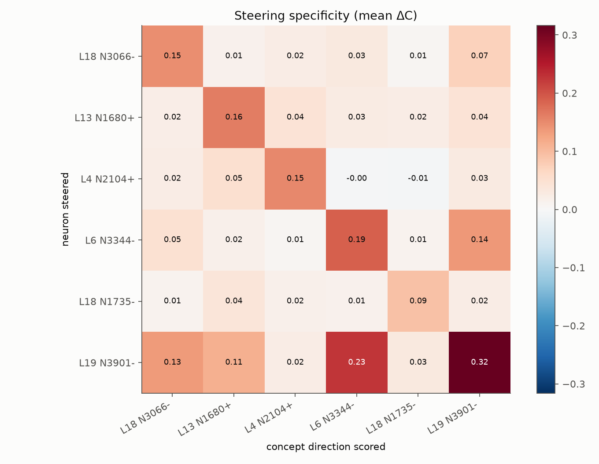
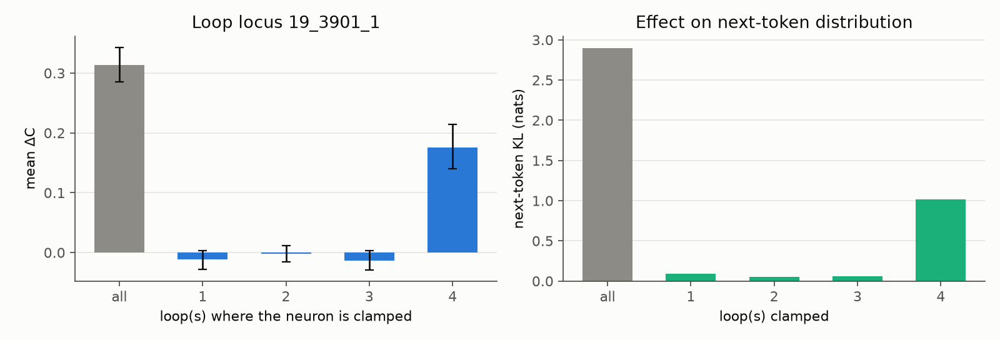

# Experiment 4: Follow-up causal experiments (secondary; post hoc unless stated)

**Status:** done (the LLM judge runs separately; see the end). **Data:** `results/Ouro-1.4B/followups.json`. **Tables:** generated from that file into [tables/](tables/). **Log:** `logs/*_followups.log`.

**Neurons:** the 5 confirmed neurons, plus the pre-registered exploratory if-statement neuron L19 N3901− at α = 2.

**Prompts:** confirm prompts 1–60, 1 sample each, 48 tokens, with seeds distinct from the confirmatory run. These analyses come after the confirmatory decision and do not feed back into it.

## 1. Specificity: does a neuron push toward *its own* concept?
Each cell is the mean ΔC on the column neuron's concept direction when the row neuron is steered:

| steered (rows) / scored (columns) | 18_3066 − phonetics | 13_1680 + non-duality | 4_2104 + pedagogy | 6_3344 − forum answers | 18_1735 − orbitals | 19_3901 − if-statements (expl.) |
|---|---|---|---|---|---|---|
| 18_3066 − | **0.148** | 0.014 | 0.025 | 0.030 | 0.006 | 0.073 |
| 13_1680 + | 0.021 | **0.162** | 0.043 | 0.027 | 0.022 | 0.042 |
| 4_2104 + | 0.024 | 0.050 | **0.152** | −0.003 | −0.006 | 0.028 |
| 6_3344 − | 0.049 | 0.016 | 0.007 | **0.189** | 0.011 | 0.137 |
| 18_1735 − | 0.011 | 0.038 | 0.016 | 0.015 | **0.092** | 0.024 |
| 19_3901 − | 0.134 | 0.112 | 0.024 | 0.225 | 0.032 | **0.316** |

- For the five confirmed neurons, the diagonal entry is the largest in its row, 1.4–3.7× the largest off-diagonal entry. The smallest margin is L6 N3344, whose largest off-diagonal entry is on the if-statement concept.
- The largest off-diagonal entries pair "forum accepted answer" with "programming if-statements" (0.137 and 0.225). Forum Q&A text and code overlap, so this is plausible.
- The exploratory if-statement neuron is the strongest but least specific steerer.
- 

## 2. Dose-response and the predicted sandwich-norm saturation
Steering clamps the activation to α × max|a|. The MLP write is RMS-normalized after `down_proj`, so a single clamped neuron's write is bounded. The predicted onset scale is c* ≈ ‖r‖ / ‖w_i‖ (r = the other neurons' write), measured as the median over unsteered tokens of ‖W_down a‖ / ‖w_i‖ ([methodology §2](../docs/methodology.md)).

| neuron | c*/max, in α units | ΔC at α = 0.5 / 1 / 2 / 4 / 8 / 16 | opposite-sign clamp (α = −1 / −4) | PPL ratio at α = 16 |
|---|---|---|---|---|
| L18 N3066 − | 0.77 | 0.042 / 0.149 / 0.253 / 0.324 / 0.313 / 0.338 | −0.008 / −0.009 | 2.49 |
| L13 N1680 + | 1.74 | 0.057 / 0.153 / 0.278 / 0.312 / 0.304 / 0.312 | −0.013 / −0.028 | 3.42 |
| L4 N2104 + | 2.61 | 0.024 / 0.046 / 0.142 / 0.233 / 0.282 / 0.296 | −0.015 / −0.008 | 3.37 |
| L6 N3344 − | 2.24 | 0.000 / 0.009 / 0.063 / 0.171 / 0.205 / 0.253 | −0.013 / 0.007 | 2.17 |
| L18 N1735 − | 0.90 | −0.001 / 0.042 / 0.126 / 0.155 / 0.176 / 0.175 | −0.024 / −0.037 | 1.91 |
| L19 N3901 − (expl.) | 1.07 | 0.054 / 0.201 / 0.313 / 0.334 / 0.362 / 0.365 | −0.005 / −0.002 | 1.01 (repetition) |

- **ΔC rises with α and then levels off for four of six neurons**; L4 N2104 and L6 N3344 are still rising at α = 16. The rise is not strictly monotone (dips of ≤ 0.011, inside the CIs, e.g. L18 N3066 0.324 → 0.313 from α = 4 to 8). This is qualitatively as predicted: the effect stops growing once the clamped neuron dominates its layer's MLP write.
  - Neurons with a larger c*/max saturate at a larger α: L4 N2104 and L6 N3344 (c*/max 2.2–2.6) are still rising at α = 16, while L18 N3066, L18 N1735 and L19 N3901 (c*/max 0.8–1.1) plateau from α ≈ 2–8 (L18 N1735 still gains 0.021 from α = 4 to 8).
  - We did not fit a quantitative curve, so this is a hedged, qualitative confirmation.
- **Clamping to the opposite sign does not steer toward the concept** (|ΔC| ≤ 0.04). Four of the twelve opposite-sign conditions have a small *negative* effect whose 95% CI excludes 0 (L4 N2104 at α = −1, L13 N1680 at −4, L18 N1735 at −1 and −4). This is consistent with the concept being carried by one pole.
- **Perplexity ratio rises with α**, past the guard of 2 for most neurons at α ≥ 4.
  - Exception: the if-statement neuron's ratio *falls* to ≈ 1.0, because its output becomes the repetitive "ififif…".
  - This is the failure mode the distinct-2 guard catches.

## 3. Loop locus (H2): steer only at loop t
At the confirmatory α, clamped at all loops or at a single loop:

| neuron | all loops | loop 1 | loop 2 | loop 3 | loop 4 | sum of single loops |
|---|---|---|---|---|---|---|
| L18 N3066 − | 0.149 [0.113, 0.188] | 0.008 | 0.003 | 0.003 | 0.015 | 0.029 |
| L13 N1680 + | 0.153 [0.121, 0.187] | 0.043 | 0.027 | 0.011 | 0.035 | 0.116 |
| L4 N2104 + | 0.142 [0.111, 0.175] | 0.007 | 0.010 | 0.013 | 0.012 | 0.043 |
| L6 N3344 − | 0.171 [0.135, 0.209] | 0.006 | 0.014 | 0.012 | 0.016 | 0.047 |
| L18 N1735 − | 0.126 [0.087, 0.165] | −0.000 | 0.004 | −0.003 | −0.004 | −0.003 |
| L19 N3901 − (expl.) | 0.313 [0.285, 0.343] | −0.012 | −0.002 | −0.013 | **0.176 [0.141, 0.214]** | 0.150 |

- **Behavioral effects are strongly super-additive across loops.** For four of five confirmed neurons, the four single-loop effects together give −2% to 30% of the all-loop effect, and no single loop alone reaches ΔC 0.05.
  - A single injection is mostly undone by the following loops. Behaviorally this matches the last-loop advantage of [nesiacel (2026)](https://www.lesswrong.com/posts/rzcJMpnehFBD686gj/), who reports early injections being "rotated away" and suggests self-repair, and it is consistent with self-repair in feedforward models ([McGrath et al. 2023](https://arxiv.org/abs/2307.15771)).
  - Mechanistically, a last-loop injection displaces the final state most: relative displacement 0.20–0.47 at loop 4 vs 0.12–0.23 at loops 1–3.
  - Next-token KL is largest at loop 1 or loop 4, and U-shaped for 4 of 6 neurons.
- **Exception (exploratory neuron):** for L19 N3901, clamping only at loop 4 gives 56% of the all-loop effect (p = 1.7e-10), while loops 1–3 alone give nothing. This matches the "last loop is most effective" finding for residual-direction steering of Ouro-1.4B-Thinking.
- **Verdict on H2** ("later loops matter more"): only partly supported. The last loop is the most effective single loop for 3 of 6 neurons (L18 N3066, L6 N3344, L19 N3901); L13 N1680 is most affected at loop 1. For five of six neurons no single loop suffices.
- 

## 4. Test-time loops (H3): clamp at every loop while running T = 1…8 loops (T > 4 is extrapolation)
| neuron | ΔC at T = 1 / 2 / 3 / 4 / 5 / 6 / 7 / 8 | next-token KL at T = 1 → 8 |
|---|---|---|
| L18 N3066 − | 0.113 / 0.228 / 0.145 / 0.149 / 0.242 / 0.215 / 0.245 / 0.226 | 0.13 → 1.00 |
| L13 N1680 + | 0.108 / 0.148 / 0.138 / 0.153 / 0.181 / 0.176 / 0.170 / 0.175 | 0.08 → 1.18 |
| L4 N2104 + | 0.101 / 0.113 / 0.126 / 0.142 / 0.164 / 0.135 / 0.161 / 0.160 | 0.16 → 0.81 |
| L6 N3344 − | 0.155 / 0.225 / 0.182 / 0.171 / 0.199 / 0.163 / 0.195 / 0.200 | 0.24 → 1.03 |
| L18 N1735 − | 0.125 / 0.195 / 0.164 / 0.126 / 0.178 / 0.163 / 0.200 / 0.176 | 0.17 → 1.53 |
| L19 N3901 − (expl.) | 0.348 / 0.351 / 0.332 / 0.313 / 0.341 / 0.330 / 0.331 / 0.339 | 1.99 → 3.07 |

- A single pass (T = 1) already shows the concept effect (ΔC 0.10–0.35).
- Behavioral ΔC does not grow systematically with T. For the confirmed neurons, ΔC at T = 1 is 70–99% of its T = 4 value, and from T = 2 to 8 it fluctuates between 0.113 and 0.245 with no monotone trend; T = 5–8 values are mostly at or above T = 4. Next-token KL grows with T, apart from small dips for 3 of 6 neurons (≤ 0.06).
- More loops mean more injections and more change in the output distribution, but not proportionally more concept content.
- We see no evidence of a looped-specific amplification of steering with T. Each T is compared with its own unsteered baseline, and T > 4 runs outside the trained regime.

## 5. Zero-ablation (necessity; exploratory)
Each neuron is set to 0 at all loops on its held-out top contexts (atlas ranks 21–40; 19 for L6 N3344, whose peak at the last position has no next token) and we measure the NLL change of the token after the peak. This is compared with 100 random same-layer neuron ablations, in the spirit of Goodfire's random same-layer ablation control ([Cammarata 2026](https://already-clean.goodfire.com/)).

| neuron | ΔNLL (nats) | null mean (95th pct) | z | empirical p (unadjusted) |
|---|---|---|---|---|
| L18 N3066 − | +0.024 | 0.007 (0.015) | 3.1 | 0.0099 |
| L13 N1680 + | −0.012 | −0.004 (0.004) | −1.3 | 0.90 |
| L4 N2104 + | +0.070 | −0.005 (0.005) | 11.7 | 0.0099 |
| L6 N3344 − | −0.071 | 0.001 (0.014) | −8.9 | 1.00 |
| L18 N1735 − | +0.132 | −0.011 (−0.003) | 31.2 | 0.0099 |
| L19 N3901 − (expl.) | +0.413 | −0.001 (0.010) | 53.6 | 0.0099 |

- Four of six neurons are individually necessary for predicting the next token in their own contexts beyond any random same-layer neuron.
- Correcting with Holm across the six would give 0.059, so this is a hedged, exploratory claim.
- L6 N3344: ablation *improves* prediction (z = −8.9). The neuron is sufficient to steer toward its concept but works against the actual continuations in its top contexts.
- L13 N1680: no necessity effect.

## 6. LLM judge (secondary, pre-registered)
- **Setup:** a local Qwen3.5-9B with the AxBench concept and fluency templates (0–2). It rated continuations of the first 50 confirm prompts, unsteered and steered at each neuron's pre-registered α. Each continuation was judged in its own call, in shuffled order, so the judge was blind to condition.
- **Files:** `results/Ouro-1.4B/llm_judge.json` and `llm_judge_texts.json` (all continuations). The log has every judge prompt and output.

| neuron | concept rating unsteered → steered | one-sided Wilcoxon p (Holm) | fluency unsteered → steered [95% CI of Δ] |
|---|---|---|---|
| L18 N3066 − | 0.00 → 0.26 | 0.0031 (0.0062) | 1.50 → 1.14 [−0.60, −0.12] |
| L13 N1680 + | 0.00 → 0.24 | 0.00067 (0.0027) | 1.50 → 1.12 [−0.60, −0.16] |
| L4 N2104 + | 0.02 → 0.26 | 0.00067 (0.0027) | 1.50 → 1.17 [−0.54, −0.13] |
| L6 N3344 − | 0.00 → 0.06 | 0.042 (0.042) | 1.50 → 0.90 [−0.86, −0.34] |
| L18 N1735 − | 0.00 → 0.36 | 0.00014 (0.0007) | 1.50 → 1.10 [−0.63, −0.16] |

- The judge agrees with the embedding metric for all five neurons: the concept rating increases, and all pass Holm (Holm values computed by `reporting.judge_holm`, [tables/audit_judge.md](tables/audit_judge.md)).
- It is strict (ratings are rarely above 0), so absolute values are low.
- The forum-answer neuron, the most abstract concept, is weakest by this measure.
- Fluency drops by 0.33–0.60 points on the 0–2 scale, consistent with the perplexity ratios.

## Learnings
- **Steering effect and necessity can come apart** (L6 N3344, L13 N1680). Sufficiency (steering) and necessity (ablation) should be reported separately.
- **Steering requires repeated injection.** A looped model mostly undoes a single-loop injection of one neuron, so neuron steering in looped models should clamp at every loop.
- **Saturation is consistent with the sandwich RMSNorm bound** (qualitatively; no curve was fitted, and two neurons still rise at α = 16). Very large clamps buy little concept and cost a lot of fluency, so α between 1 and 4 × max is the useful range here.
