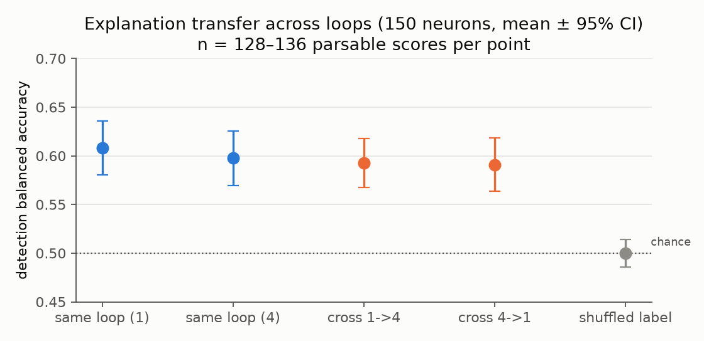

# Experiment 5: Loop structure of neurons and LLM interpretability audit (H4)

**Status:** done. **Data:** `results/Ouro-1.4B/loop_structure.json`, `results/Ouro-1.4B/cross_loop_corr.npz` (per-neuron 4×4 correlation matrices), `results/Ouro-1.4B/audit.json`. **Log:** `logs/20261025-015515_audit.log` (every Qwen prompt and output in full).

The question is whether a looped neuron does the same job at every loop. The weights are identical at every loop, but the input distribution changes from loop to loop.

## A. Activation-level loop structure (all 135,168 neurons; descriptive)
1. **Where the strongest activation happens** (from the atlas, both poles pooled): loop 1 41.0%, loop 2 29.7%, loop 3 16.7%, loop 4 12.7%. Early loops host most extreme activations.
2. **Top-20 context overlap** (Jaccard of chunk ids, from the atlas, positive pole, 500 random alive neurons per layer):
   - loop 1 vs 4: 0.01 (layer 0) up to 0.18–0.19 (layers 16–19), then 0.14 at layer 23;
   - adjacent loops, averaged over layers: 0.14 (loops 1→2), 0.28 (2→3), 0.45 (3→4).
3. **Same-token activation correlation** (Pearson, per neuron, over 32,256 held-out FineWeb-Edu tokens):
   - loop 1 vs 4: median r = **0.54** (10th/25th/75th/90th percentiles 0.18 / 0.43 / 0.63 / 0.67);
   - 13.9% of neurons have r < 0.3 and 4.4% have r > 0.7;
   - by layer, the median r(1,4) rises from ≈ 0.00 (layer 0) and 0.09 (layer 1) to 0.45–0.48 (layers 4–11) and 0.59–0.65 (layers 14–23);
   - adjacent loops: median r(1,2) = 0.65, r(2,3) = 0.84, r(3,4) = 0.94.

Interpretation (hedged):
- A neuron's activation pattern at loop 4 is related to, but clearly not the same as, its pattern at loop 1.
- The change shrinks loop by loop, as expected if the residual stream approaches a fixed point ([Blayney et al. 2026](https://arxiv.org/abs/2604.11791)).
- Layer 0 is the extreme case. At loop 1 it reads token embeddings, but at loops 2–4 it reads the normalized output of the previous loop, so its loop-1 and loop-4 activations are uncorrelated.
- Top-k overlap (method 2) shows much less similarity than correlation (method 3). The two measure different things: top-20 sets cover only the extreme tail and are sensitive to near-ties among many similar contexts, while correlation covers all tokens. How much of the gap comes from ties was not tested.
- 

## B. LLM audit: do explanations transfer across loops? (H4)
**Design:**
- 150 alive neurons, 50 per layer tercile, positive pole.
- For loop 1 and loop 4 separately, the local Qwen3.5-9B writes an explanation from that loop's top-12 contexts with the Delphi explainer system prompt, without Delphi's few-shot demonstrations ([Paulo et al. 2024](https://arxiv.org/abs/2410.13928)).
- The detection scorer then judges 8 held-out activating contexts (ranks 13–20 at a given loop) and 8 random contexts.
- Explanations are scored on the same loop, on the other loop (cross-loop), and against a shuffled explanation from another neuron (chance control).

| score (balanced accuracy) | mean | SD | n (parsable) |
|---|---|---|---|
| same loop, loop 1 | 0.608 | 0.160 | 128 |
| same loop, loop 4 | 0.598 | 0.165 | 135 |
| cross loop, loop-1 explanation on loop-4 contexts | 0.592 | 0.146 | 131 |
| cross loop, loop-4 explanation on loop-1 contexts | 0.591 | 0.161 | 132 |
| shuffled explanation (chance control) | 0.500 | 0.084 | 136 |

- **H4 (explanations are loop-specific) is not supported.** Same-loop minus cross-loop, paired by explanation (loop-1 and loop-4 explanations pooled): +0.012, paired two-sided Wilcoxon p = 0.20, n = 240 ([tables/audit_judge.md](tables/audit_judge.md), computed by `reporting.audit_tests`).
- **Explanations carry real information** but are weak: loop-4 same-loop vs shuffled explanation (both scored on loop-4 contexts) is +0.097, paired two-sided Wilcoxon p = 1.4e-7, n = 123.
- **Few neurons are well explained:** among parsable scores, only 25% (loop 1; 32/128, Wilson 95% CI 18–33%) and 21% (loop 4; 28/135, CI 15–28%) of neurons reach balanced accuracy ≥ 0.75 ([Experiment 7](07_plan_completion.md); an earlier version counted unparsable neurons as failures).
- **This is a negative result with a low ceiling.** A 4-bit 9B local labeler working from 12 examples produces explanations that detect activating contexts only modestly. That limits the sensitivity of any cross-loop comparison, so we cannot rule out loop-specific function that a stronger explainer would reveal. The activation correlations in Part A are the more sensitive measure here.
- **Comparison with Goodfire.** Goodfire's estimate that ≈ 90% of Qwen3-32B neuron poles have "one main job" ([Cammarata 2026](https://already-clean.goodfire.com/)) comes from Goodfire's "preliminary audits" of that dense model, a different procedure from our detection-score audit. Our numbers are not comparable estimates of the same quantity.
- **Parse failures.** Each detection score uses two LLM calls (10 + 6 items). 473 of 1,500 calls (31.5%) could not be parsed; their items were dropped. 88 of 750 scores (11.7%) are NaN in `audit.json` and excluded (86 with no parsable call, 2 whose parsed items contained only one class); the others rest on 6, 10 or 16 items.
- 

## Learnings
- **Use correlation, not just top-k overlap.** Activation correlation on shared tokens is a cheap, robust measure of cross-loop function. Top-k context overlap alone would have suggested near-total change between loops; the bulk of each neuron's activations changes much less (median r = 0.54).
- **The explainer bounds the audit.** With local models, explanation quality is the limiting factor. A larger explainer, or more examples per explanation, would raise the ceiling, but only within the hardware limits of this study (8 GB VRAM).
- **Infrastructure.** The Windows console uses cp1252, so LLM text containing arbitrary Unicode raised non-fatal logging errors. stdout is now reconfigured to UTF-8. The file logs were always complete.
